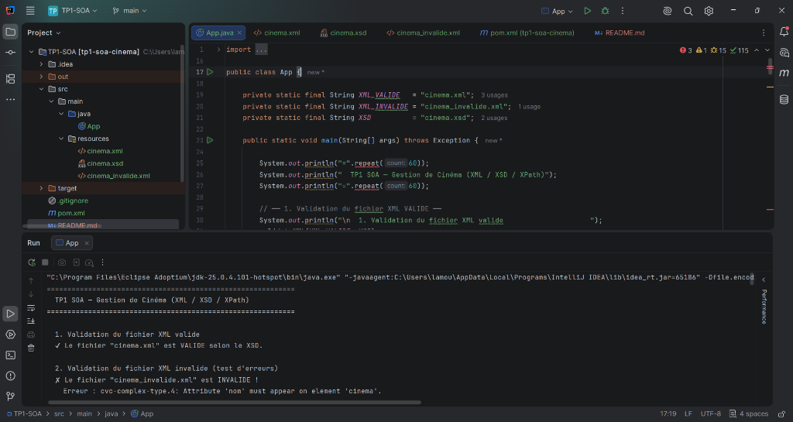
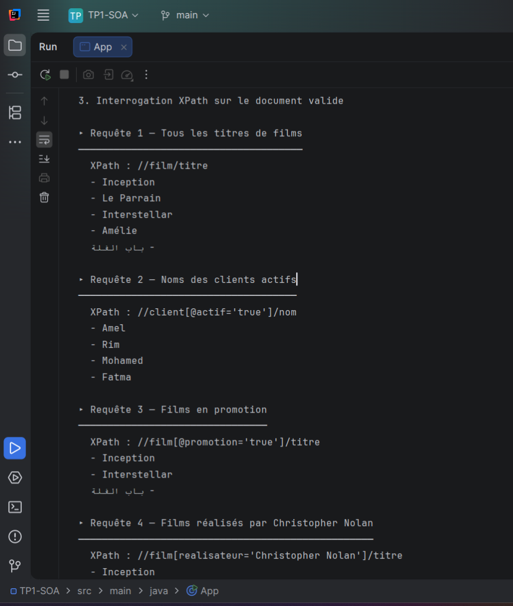
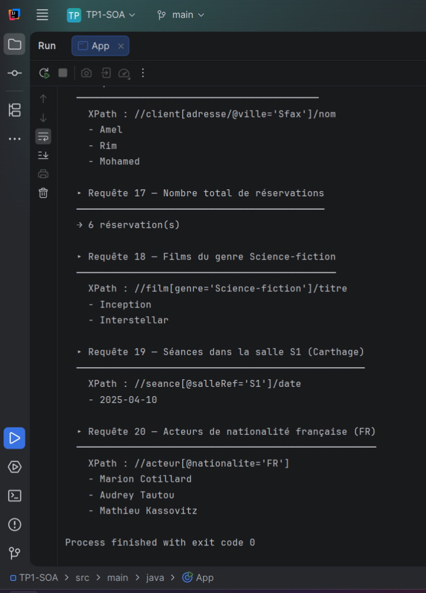

# Compte Rendu — TP1 SOA

> **Réalisé par** : Yassine Lamouchi  
> **Groupe** : LSI3 2.1  
> **Module** : Architecture Orientée Services (SOA)

---

# TP1 SOA — Gestion de Cinéma (XML, XSD, XPath, Maven)

## Domaine choisi

Le domaine choisi est la **gestion de cinéma** (CinéStar Sfax).  
Il permet de modéliser un système complet de réservation de cinéma avec les entités suivantes :

- **Films** : catalogue des films avec acteurs, réalisateur, genre, durée, note, langue, prix et synopsis.
- **Salles** : salles de projection avec type (IMAX, 3D, VIP, Standard), capacité et équipements.
- **Clients** : base de données des clients avec abonnement, adresse et coordonnées.
- **Séances** : programmation des projections liant un film à une salle avec horaire et places disponibles.
- **Réservations** : réservations des clients pour des séances avec montant, paiement et statut.

## Arborescence du projet

```text
TP1-SOA/
├── pom.xml                            ← Configuration Maven
├── README.md                          ← Documentation (ce fichier)
├── screenshots/                       ← Captures d'écran
│   ├── validation_et_code.png
│   ├── xpath_resultats_1.png
│   └── xpath_resultats_2.png
└── src/
    └── main/
        ├── java/
        │   └── App.java               ← Classe Java principale
        └── resources/
            ├── cinema.xml             ← Document XML valide
            ├── cinema_invalide.xml    ← Document XML invalide (test)
            └── cinema.xsd            ← Schéma XSD de validation
```

## Description des fichiers

| Fichier               | Rôle                                                                                        |
| --------------------- | ------------------------------------------------------------------------------------------- |
| `pom.xml`             | Fichier Maven avec la configuration du projet et le plugin d'exécution.                     |
| `cinema.xml`          | Document XML **valide** contenant les films, salles, clients, séances et réservations.      |
| `cinema_invalide.xml` | Document XML **invalide** contenant 9 erreurs volontaires pour tester la validation XSD.    |
| `cinema.xsd`          | Schéma XSD complet avec types simples personnalisés, énumérations, patterns et contraintes. |
| `App.java`            | Classe Java principale : validation XML/XSD (valide + invalide) et 20 requêtes XPath.       |
| `README.md`           | Documentation du projet (ce fichier).                                                       |

## Structure XML

Le document XML possède un élément racine `<cinema>` avec les attributs `nom`, `ville`, `pays` et `dateOuverture`.  
Il contient cinq sections principales :

### 1. Films (`<films>`)

Chaque `<film>` possède :

- **Attributs** : `id`, `promotion`, `langue` (code ISO 639-1), `duree` (minutes), `note` (sur 10).
- **Éléments enfants** : `titre`, `realisateur` (avec attribut `nationalite`), `genre`, `annee`, `prix` (avec attribut `devise`), `synopsis`, `acteurs` (liste d'`acteur` avec attributs `role` et `nationalite`).

### 2. Salles (`<salles>`)

Chaque `<salle>` possède :

- **Attributs** : `id`, `type` (Standard, 3D, IMAX, VIP), `climatisee`.
- **Éléments enfants** : `nomSalle`, `capacite`, `equipements` (liste d'`equipement`).

### 3. Clients (`<clients>`)

Chaque `<client>` possède :

- **Attributs** : `id`, `actif`, `typeAbonnement` (Standard, Premium, Étudiant, Senior), `dateInscription`.
- **Éléments enfants** : `nom`, `prenom`, `email`, `telephone`, `adresse` (avec attributs `ville` et `codePostal`).

### 4. Séances (`<seances>`)

Chaque `<seance>` possède :

- **Attributs** : `id`, `filmRef`, `salleRef`, `statut` (active, complete, annulee).
- **Éléments enfants** : `date`, `heure`, `prixSeance` (avec attribut `devise`), `placesDisponibles`.

### 5. Réservations (`<reservations>`)

Chaque `<reservation>` possède :

- **Attributs** : `id`, `clientRef`, `seanceRef`, `statut` (confirmee, en_attente, annulee).
- **Éléments enfants** : `dateReservation`, `nombrePlaces`, `montantTotal` (avec attribut `devise`), `methodePaiement`.

## Schéma XSD — Types personnalisés

Le schéma XSD définit plusieurs types simples avec des contraintes :

| Type                    | Base                     | Contrainte                                        |
| ----------------------- | ------------------------ | ------------------------------------------------- |
| `IdType`                | `xs:string`              | Pattern `[A-Z]{1,2}[0-9]+`                        |
| `DeviseType`            | `xs:string`              | Énumération : TND, EUR, USD                       |
| `NationaliteType`       | `xs:string`              | Pattern `[A-Z]{2}` (ISO 3166-1 alpha-2)           |
| `NoteType`              | `xs:decimal`             | Min 0.0, Max 10.0                                 |
| `DureeType`             | `xs:positiveInteger`     | Max 600 minutes                                   |
| `LangueType`            | `xs:string`              | Pattern `[a-z]{2}` (ISO 639-1)                    |
| `StatutSeanceType`      | `xs:string`              | Énumération : active, complete, annulee           |
| `StatutReservationType` | `xs:string`              | Énumération : confirmee, en_attente, annulee      |
| `AbonnementType`        | `xs:string`              | Énumération : Standard, Premium, Étudiant, Senior |
| `TypeSalleType`         | `xs:string`              | Énumération : Standard, 3D, IMAX, VIP             |
| `MontantType`           | `xs:decimal` (extension) | Attribut `devise` obligatoire                     |
| `AdresseType`           | `xs:string` (extension)  | Attributs `ville` et `codePostal` obligatoires    |

## Fichier XML invalide — Erreurs volontaires

Le fichier `cinema_invalide.xml` contient **9 erreurs volontaires** pour démontrer la validation XSD :

| #   | Erreur                           | Détail                                                                   |
| --- | -------------------------------- | ------------------------------------------------------------------------ |
| 1   | Attribut `nom` manquant          | L'élément racine `<cinema>` ne possède pas l'attribut obligatoire `nom`. |
| 2   | `duree` invalide                 | La valeur `"abc"` n'est pas un entier positif.                           |
| 3   | `note` hors bornes               | La valeur `15.0` dépasse le maximum autorisé de `10.0`.                  |
| 4   | `langue` invalide                | `"ENG"` ne correspond pas au pattern `[a-z]{2}`.                         |
| 5   | `type` de salle invalide         | `"Plein Air"` n'est pas dans l'énumération autorisée.                    |
| 6   | Élément `<prenom>` manquant      | Obligatoire dans la séquence du `ClientType`.                            |
| 7   | `typeAbonnement` invalide        | `"Gold"` n'existe pas dans l'énumération.                                |
| 8   | `statut` de séance invalide      | `"en_cours"` n'est pas dans l'énumération `StatutSeanceType`.            |
| 9   | Section `<reservations>` absente | Obligatoire dans la séquence de l'élément racine.                        |

## Requêtes XPath utilisées (20 requêtes)

| #   | Objectif                          | Requête XPath                                     |
| --- | --------------------------------- | ------------------------------------------------- |
| 1   | Tous les titres de films          | `//film/titre`                                    |
| 2   | Clients actifs                    | `//client[@actif='true']/nom`                     |
| 3   | Films en promotion                | `//film[@promotion='true']/titre`                 |
| 4   | Films de Christopher Nolan        | `//film[realisateur='Christopher Nolan']/titre`   |
| 5   | Films de plus de 150 min          | `//film[@duree > 150]/titre`                      |
| 6   | Films avec note ≥ 9.0             | `//film[@note >= 9.0]/titre`                      |
| 7   | Nombre total de films             | `count(//film)`                                   |
| 8   | Salles IMAX                       | `//salle[@type='IMAX']/nomSalle`                  |
| 9   | Salles climatisées                | `//salle[@climatisee='true']/nomSalle`            |
| 10  | Séances actives                   | `//seance[@statut='active']/date`                 |
| 11  | Réservations confirmées (montant) | `//reservation[@statut='confirmee']/montantTotal` |
| 12  | Clients abonnés Premium           | `//client[@typeAbonnement='Premium']/nom`         |
| 13  | Acteurs du film Inception         | `//film[titre='Inception']/acteurs/acteur`        |
| 14  | Films en français                 | `//film[@langue='fr']/titre`                      |
| 15  | Capacité totale des salles        | `sum(//salle/capacite)`                           |
| 16  | Clients de Sfax                   | `//client[adresse/@ville='Sfax']/nom`             |
| 17  | Nombre de réservations            | `count(//reservation)`                            |
| 18  | Films Science-fiction             | `//film[genre='Science-fiction']/titre`           |
| 19  | Séances en salle S1               | `//seance[@salleRef='S1']/date`                   |
| 20  | Acteurs français                  | `//acteur[@nationalite='FR']`                     |

## Exécution

```bash
mvn clean compile
mvn exec:java
```

Ou exécuter directement la classe `App` dans IntelliJ IDEA.

## Captures d'écran

### Validation XML/XSD et structure du code



### Résultats XPath (Requêtes 1 à 4)



### Résultats XPath (Requêtes 16 à 20)


